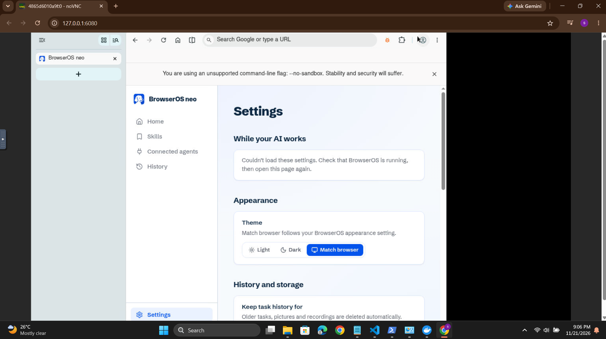
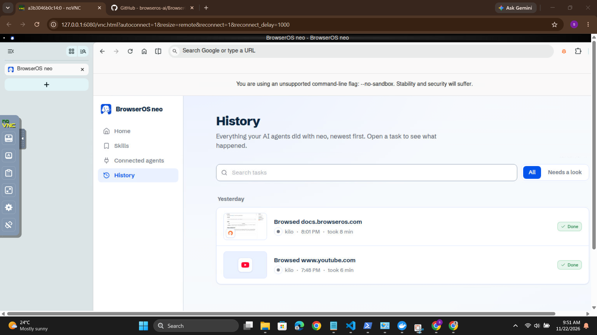

# BrowserOS Neo — Dockerized (noVNC + MCP)

Docker setup for running [BrowserOS Neo](https://github.com/browseros-ai/BrowserOS), the open-source agent browser, inside a Linux container with a web GUI (noVNC) and a host-accessible MCP endpoint for VS Code/Kilo/other MCP clients.

> **Upstream project:** BrowserOS Neo is developed by the BrowserOS team and is open source under [AGPL-3.0](https://github.com/browseros-ai/BrowserOS/blob/main/LICENSE).  
> This repository packages the official BrowserOS Neo Linux build for Docker use; it is not a replacement for the upstream project.

## Screenshots

| BrowserOS Neo in Docker (noVNC) | MCP / BrowserOS Neo view |
|---|---|
|  |  |

## References (Open Source BrowserOS Neo)

- **GitHub:** https://github.com/browseros-ai/BrowserOS
- **Website:** https://browseros.com
- **Docs:** https://docs.browseros.com
- **Downloads:** https://browseros.com/download/
- **Linux installers used by this Docker build:**  
  - DEB: https://cdn.browseros.com/download/BrowserOS_neo.deb  
  - AppImage: https://cdn.browseros.com/download/BrowserOS_neo.AppImage
- **License:** https://github.com/browseros-ai/BrowserOS/blob/main/LICENSE (AGPL-3.0)

## What Is BrowserOS Neo

BrowserOS Neo is a Chromium-based, local-first browser built for AI agents. Instead of giving agents a blank/headless browser, Neo lets agents work in a real browser with your logged-in sessions, while you can observe/replay activity.

Key upstream capabilities (from BrowserOS Neo):

- **Real browser for agents** — agents operate on real tabs/web pages.
- **Your logins/sessions** — imports/use existing browser profile context; designed for real signed-in work.
- **MCP integration** — connects to MCP-capable AI tools/agents.
- **Live dashboard & replay** — observe agent runs and replay sessions (in Neo UI).
- **Local-first/privacy-oriented** — sessions/history/artifacts are stored locally on the user machine (see upstream privacy docs).
- **Open source** — AGPL-3.0, actively developed in the BrowserOS monorepo.

## What This Docker Repo Provides

This repo makes BrowserOS Neo runnable in a containerized desktop environment:

- **Ubuntu 24.04 base** for GLIBC compatibility with BrowserOS Neo MCP sidecar.
- **noVNC web GUI** at `http://localhost:6080`.
- **Raw VNC** at `localhost:5900`.
- **MCP endpoint** exposed at `http://127.0.0.1:9010/mcp`.
- **Auto-download installer** during Docker build (default CDN `.deb`), with optional local installer override.
- **Persistent profile volume** so browser data survives container recreation.
- **Startup fixes** for stale Chromium singleton locks and MCP Docker-forwarding behavior.

## Repository Layout

| File | Purpose |
|---|---|
| `Dockerfile` | Builds Ubuntu 24.04 image, installs GUI/runtime deps, downloads/installs BrowserOS Neo, configures startup. |
| `docker-compose.yml` | Container name, ports, resolution env, volumes, build args for installer URLs. |
| `install-browseros.sh` | Uses local `./installer/*.deb|*.AppImage` if present; otherwise downloads from BrowserOS CDN. |
| `start.sh` | Starts Xvfb/fluxbox/x11vnc/websockify, cleans stale locks, bridges MCP ports, launches BrowserOS as `browser`. |
| `.vscode/mcp.json` | Workspace VS Code MCP config pointing to `http://127.0.0.1:9010/mcp`. |
| `changes_made__worked.md` | Detailed changelog, root causes, verification, and scratch-install notes. |
| `installer/` | Optional local installer drop location (`.deb` preferred, `.AppImage` supported). |

## How It Runs

1. **Docker build** installs GUI dependencies (`xvfb`, `x11vnc`, `novnc`, `websockify`, `fluxbox`, etc.) and BrowserOS Neo.
2. **Installer selection** (`install-browseros.sh`):
   - If `./installer/` contains a supported Linux installer, uses it (`.deb` preferred, then `.AppImage`, `.exe` ignored).
   - If not, downloads from `BROWSEROS_INSTALLER_URL` (default: BrowserOS Neo CDN `.deb`).
3. **Container startup** (`start.sh`):
   - Creates/fixes ownership for `/home/browser/data` and `/downloads`.
   - Removes stale Chromium/X locks (`SingletonLock/Cookie/Socket`, `/tmp/.X0-lock`, X11 socket).
   - Starts virtual display: `Xvfb :0`.
   - Starts window manager: `fluxbox`.
   - Starts VNC server: `x11vnc` on `5900`.
   - Starts noVNC/websockify on `6080`.
   - Starts MCP bridges with `socat`: `0.0.0.0:9015 -> 127.0.0.1:9010`, `0.0.0.0:9016 -> 127.0.0.1:9011`.
   - Launches BrowserOS Neo as `browser` user with `--no-sandbox --disable-dev-shm-usage --disable-gpu --user-data-dir=/home/browser/data`.
4. **Docker port mapping** exposes:
   - `127.0.0.1:6080 -> 6080` (noVNC)
   - `127.0.0.1:5900 -> 5900` (VNC)
   - `127.0.0.1:9010 -> 9015` (MCP bridge to Neo MCP 9010)
   - `127.0.0.1:9011 -> 9016` (secondary bridge)

### Why the MCP bridge exists

BrowserOS Neo MCP listens on `9010` but rejects non-loopback Docker-forwarded connections in this setup (`ECONNRESET`/empty reply from host). `socat` bridges a host-published port to loopback inside the container, making `http://127.0.0.1:9010/mcp` usable from the host.

## Prerequisites

- Docker Desktop with **Linux containers** enabled.
- Internet access during build for auto-download (unless you provide local installer in `./installer/`).
- Enough disk space for image/build and browser profile volume.

## Quick Start (Fresh Install)

```powershell
cd <repo>
docker compose up --build -d
```

Optional clean reset (removes old profile volume):

```powershell
docker compose down -v --remove-orphans
docker compose up --build -d
```

## Access

- **GUI (noVNC):** http://localhost:6080
- **Raw VNC:** localhost:5900
- **MCP:** http://127.0.0.1:9010/mcp

## Verify

Check container:

```powershell
docker compose ps
docker compose logs --tail 80 browseros
```

Probe MCP from host (expects `200`):

```powershell
docker exec browseros-original python3 -c "import json,urllib.request; req=urllib.request.Request('http://127.0.0.1:9010/mcp',data=json.dumps({'jsonrpc':'2.0','id':1,'method':'initialize','params':{'protocolVersion':'2024-11-05','capabilities':{},'clientInfo':{'name':'probe','version':'1'}}}).encode(),headers={'Content-Type':'application/json','Accept':'application/json, text/event-stream'}); r=urllib.request.urlopen(req,timeout=10); print(r.status)"
```

## Connect MCP Clients

### VS Code

Workspace config is included: `.vscode/mcp.json`

```json
{
  "servers": {
    "browseros": {
      "type": "http",
      "url": "http://127.0.0.1:9010/mcp"
    }
  }
}
```

After container is running: `Ctrl+Shift+P` → `MCP: List Servers` → Start/Restart `browseros`. Reload window if needed.

### Kilo / other MCP clients

Configure a remote/HTTP MCP server pointing to:

```text
http://127.0.0.1:9010/mcp
```

Kilo example (`kilo.jsonc`):

```jsonc
{
  "mcp": {
    "browseros": {
      "type": "remote",
      "url": "http://127.0.0.1:9010/mcp",
      "enabled": true,
      "timeout": 15000
    }
  }
}
```

## Configuration

### Resolution / display size

Default: `1600x900x24` in `docker-compose.yml`.

```powershell
$env:RESOLUTION="1366x768x24"; docker compose up -d --force-recreate
```

In noVNC sidebar, use **Local Scaling** or **Remote Resizing**.

### Installer source

- **Default:** auto-download `https://cdn.browseros.com/download/BrowserOS_neo.deb`.
- **Local installer:** place `.deb`/`.AppImage` in `./installer/` before build.
- **Override URL:**

```powershell
$env:BROWSEROS_INSTALLER_URL="https://cdn.browseros.com/download/BrowserOS_neo.AppImage"
docker compose up --build -d
```

### Optional binary override

Set `BROWSEROS_BIN` in `docker-compose.yml` if auto-detection fails.

## Data / Persistence

- **Browser profile:** Docker volume `browseros-data` mounted at `/home/browser/data`.
- **Downloads:** host `./downloads` mounted at `/downloads`.

`docker compose down` keeps volumes. `docker compose down -v` removes them.

## Remove / Prune / Reinstall

```powershell
# Rebuild, keep profile data
docker compose down
docker compose up --build -d

# Full project reset (removes browseros-data volume)
docker compose down -v --remove-orphans
docker compose up --build -d

# Full reset + remove local project image
docker compose down -v --remove-orphans --rmi local
docker compose up --build -d
```

Docker-wide cleanup (careful, affects unused Docker resources globally):

```powershell
docker system prune -a
docker system prune -a --volumes   # DANGER: removes unused volumes
```

## Troubleshooting

- **MCP 503 / sidecar failing:** ensure image is based on Ubuntu 24.04+ compatible GLIBC. This repo already uses `ubuntu:24.04`.
- **`ECONNRESET` from host to MCP:** ensure socat bridge is running and compose maps `9010->9015`, `9011->9016`.
- **Container restart loop / SingletonLock errors:** stale profile locks; `start.sh` cleans them on startup. For a hard reset, `docker compose down -v`.
- **No GUI:** check `docker compose logs -f browseros`; confirm `6080/5900` mapped and not blocked locally.
- **Build can’t download installer:** check internet/proxy/firewall or place installer in `./installer/`.
- **VS Code MCP not connecting:** reload window, restart MCP server, confirm container up and MCP probe returns `200`.

More details: [`changes_made__worked.md`](./changes_made__worked.md).

## Security / Local Use Notes

- Ports are bound to `127.0.0.1` in compose by default; keep them local unless you intentionally expose them.
- BrowserOS Neo runs with `--no-sandbox` in this containerized desktop setup; treat the container as a trusted local runtime.
- MCP endpoint gives agents browser-control capabilities; only connect trusted local MCP clients.

## License & Attribution

- **This Docker packaging repo:** see repository license terms if added; configuration/scripts in this workspace.
- **BrowserOS Neo (upstream):** [AGPL-3.0](https://github.com/browseros-ai/BrowserOS/blob/main/LICENSE) by BrowserOS/Felafax, Inc.
- **Credits:** BrowserOS Neo is built on Chromium and includes upstream acknowledgments documented by the BrowserOS project. See upstream [README](https://github.com/browseros-ai/BrowserOS#credits).